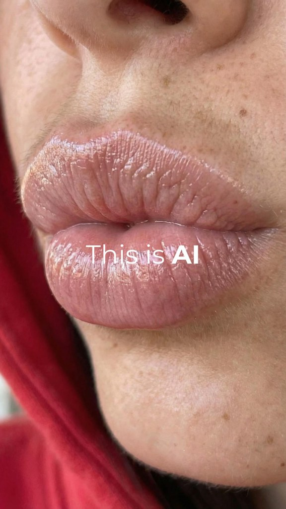

# AI tools and SaaS

**Brands of this type on Amplify:** ~41 · AI marketing and social media automation, AI influencer marketing, business and workflow automation, AI app builders, analytics for founders, job application tools, web and software agencies

> ⚠️ ReelFarm has few real B2B or AI-software slideshows (the best one has 363K views). Add accounts by hand.

## Slideshow niches (from ReelFarm)

| Niche | Status | Slideshows | Accounts |
|---|---|---|---|
| [apps and saas](../niches/apps-and-saas/README.md) | approved | 25 | 21 |
| [marketing](../niches/marketing/README.md) | approved | 9 | 7 |
| [creator growth](../niches/creator-growth/README.md) | approved | 11 | 7 |
| [productivity](../niches/productivity/README.md) | approved | 12 | 8 |
| [career](../niches/career/README.md) | approved | 13 | 8 |
| technology | not collected yet | | |

## Templates already studied for this type

| | Template | Type | Confidence | Status | What it is |
|---|---|---|---|---|---|
|  | [P014 Tool demo listicle](../../content-bank/P014-tool-demo-listicle/pillar.md) | slideshow | Low | draft | A cover slide (a value-promise title over a lifestyle photo) followed by one real-screen demo per slide, each with a Title Case heading naming the tool and a short benefit subheading, building a "here's what I actually use" listicle. |
|  | [P018 AI realism skin macro carousel](../../content-bank/P018-ai-realism-skin-macro-carousel/pillar.md) | slideshow | Low | draft | A 6-slide "this is ai" proof carousel where one ordinary selfie sits between extreme phone-macro close-ups of the same AI person's skin (lips, eye, nose, cheek, brow), so the viewer hunts for the fake and finds pores, freckles and fine hair instead; ends on a comment-keyword CTA. |
|  | [P020 Founder notes with meme cutouts](../../content-bank/P020-founder-notes-with-meme-cutouts/pillar.md) | slideshow | Low | draft | A 7-slide founder-lessons carousel on plain warm grey cards, a bold lowercase heading and short monospace paragraphs over a black and white meme-energy cutout of a person, moving from a pov reality-check hook through "the game changed", numbers, the main lesson and a next step to a first-person conclusion with a bio-link CTA. |
|  | [P021 Tier list chart](../../content-bank/P021-tier-list-chart/pillar.md) | slideshow | Low | draft | A 2-slide opinion carousel on a flat pale card, a "tier list of [topic]" cover around one vivid hero cut-out, then a filled S to D tier chart (plus an F row) of cut-out icons with short lowercase labels and a challenge title that pulls disagreement into the comments. |
|  | [P022 Rock paper scissors myth duel](../../content-bank/P022-rock-paper-scissors-myth-duel/pillar.md) | slideshow | Low | draft | A carousel played as rock paper scissors, two cut-out hands meeting from the left and right edges on a flat textured background, a challenge-question cover and then one round per slide where the losing gesture holds a common belief and the gesture that beats it holds the better move. |
|  | [P023 Habit ring question](../../content-bank/P023-habit-ring-question/pillar.md) | slideshow | Low | draft | A single-image "why does today feel <state>?" card, a glowing centre figure and a thin 2-line question ringed by 14 labelled cut-outs (photo objects, meme cut-outs, flat pictograms) that list the habits behind the good day, with the brand's own app icon slipped in as one habit labelled "(check bio)". |
|  | [P019 Essentials flat-lay](../../content-bank/P019-essentials-flat-lay/pillar.md) | slideshow | Medium | approved | A single-image identity starter pack on white, either an "<identity> essentials" flat-lay (outfit stacked on one side, gadgets and in-joke app widgets around it) or a "peak <identity> purchases" ring of labelled items around a centre title, so viewers tag the people who are that identity. |

## Templates that also work, with a tweak

| | Template | Type | Confidence | Status | What it is |
|---|---|---|---|---|---|
|  | [P003 Community thread screenshots](../../content-bank/P003-community-thread-screenshots/pillar.md) | slideshow | Low | draft | A soft-sell review built entirely from screenshots of a real public forum thread where someone asks "is [product] worth it?" and real users answer with a mix of jokes, routines, scores and cautions. |
|  | [P006 Numbered tip cards](../../content-bank/P006-numbered-tip-cards/pillar.md) | slideshow | High | draft | A how-to or regret-hook carousel of numbered tip cards, each a heading, a short paragraph and the mascot acting the tip out, ending on an eBook CTA or a soft app-plug bonus tip. |
|  | [P011 Deadpan desk rant](../../content-bank/P011-deadpan-desk-rant/pillar.md) | video | Low | draft | A 5-second locked-off selfie video of someone typing at a desk with a deadpan, eyes-up look, with a two-sentence workplace rant on screen from second 0 that ends in a sarcastic understatement aimed at a named coworker. |
|  | [P013 Unhinged advice request selfie](../../content-bank/P013-unhinged-advice-request-selfie/pillar.md) | slideshow | Low | draft | A single-slide, tight selfie of an exaggerated distressed face asking a direct, self-deprecating question that invites the wildest possible replies, ruling out the obvious safe answer first. |
