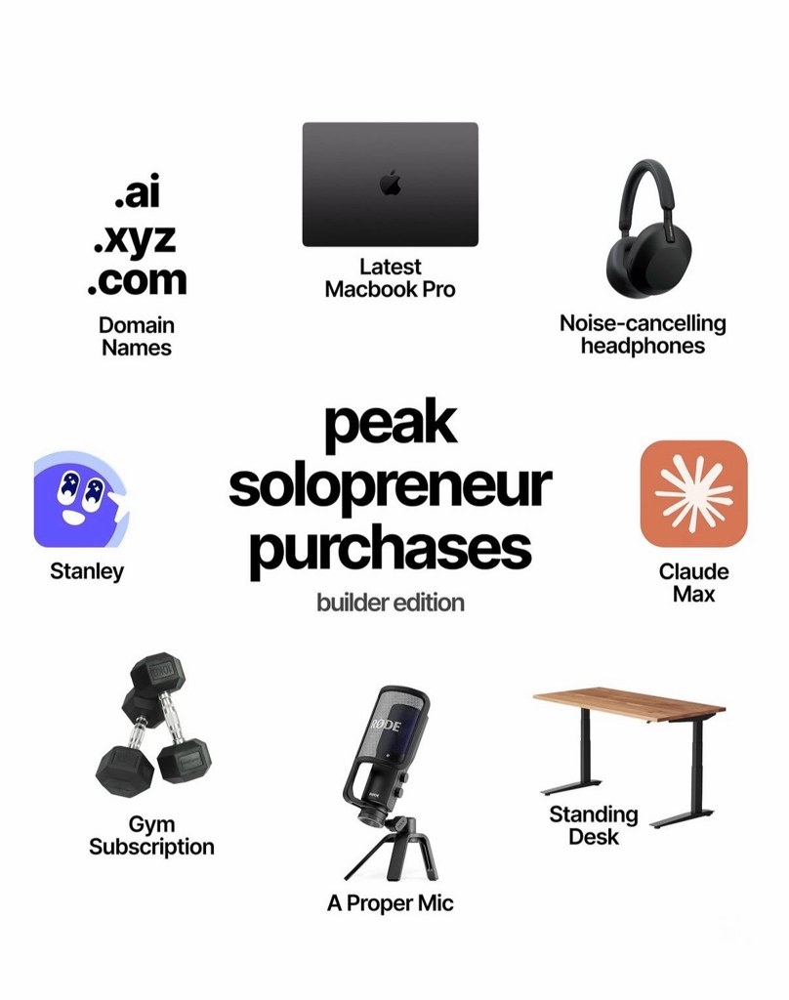

# Everything else

**Brands of this type on Amplify:** ~4 · Real estate, business marketplaces, photography, lab automation

> ⚠️ Photography has only 28 slideshows on ReelFarm, and there's nothing for lab automation or business marketplaces.

## Slideshow niches (from ReelFarm)

| Niche | Status | Slideshows | Accounts |
|---|---|---|---|
| interior design | not collected yet | | |
| photography | not collected yet | | |
| travel | not collected yet | | |

## Templates already studied for this type

| | Template | Type | Confidence | Status | What it is |
|---|---|---|---|---|---|
|  | [P014 Tool demo listicle](../../content-bank/P014-tool-demo-listicle/pillar.md) | slideshow | Low | draft | A cover slide (a value-promise title over a lifestyle photo) followed by one real-screen demo per slide, each with a Title Case heading naming the tool and a short benefit subheading, building a "here's what I actually use" listicle. |
|  | [P019 Essentials flat-lay](../../content-bank/P019-essentials-flat-lay/pillar.md) | slideshow | Medium | approved | A single-image identity starter pack on white, either an "<identity> essentials" flat-lay (outfit stacked on one side, gadgets and in-joke app widgets around it) or a "peak <identity> purchases" ring of labelled items around a centre title, so viewers tag the people who are that identity. |

## Templates that also work, with a tweak

| | Template | Type | Confidence | Status | What it is |
|---|---|---|---|---|---|
|  | [P003 Community thread screenshots](../../content-bank/P003-community-thread-screenshots/pillar.md) | slideshow | Low | draft | A soft-sell review built entirely from screenshots of a real public forum thread where someone asks "is [product] worth it?" and real users answer with a mix of jokes, routines, scores and cautions. |
|  | [P021 Tier list chart](../../content-bank/P021-tier-list-chart/pillar.md) | slideshow | Low | draft | A 2-slide opinion carousel on a flat pale card, a "tier list of [topic]" cover around one vivid hero cut-out, then a filled S to D tier chart (plus an F row) of cut-out icons with short lowercase labels and a challenge title that pulls disagreement into the comments. |
