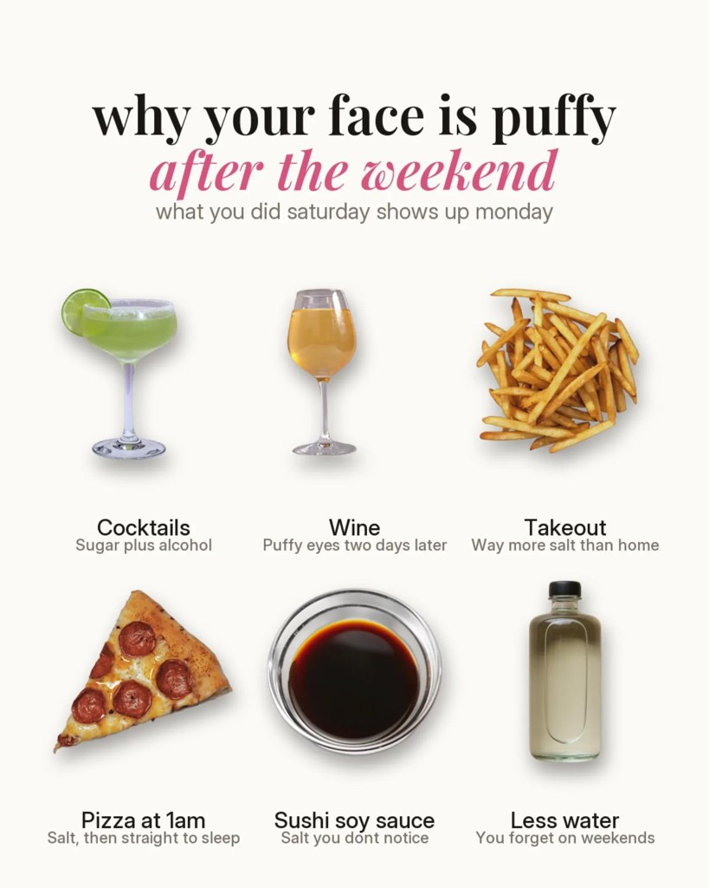

# Health, fitness and wellness

**Brands of this type on Amplify:** ~12 · Men's medical weight loss, GLP-1, smart home gym equipment, smart ring trackers, gut health tests, supplements

> ⚠️ Prescription-only medicines (GLP-1, Mounjaro, Wegovy) can't be advertised to the public in the UK: use these formats for the brand's service, never the medicine.

> Fitness formats (P005 to P009) come from one creator (@bluebro.fit) with a recurring mascot: learn the format, draw a new character.

## Slideshow niches

| Niche | Status | Slideshows | Accounts |
|---|---|---|---|
| [fitness](../niches/fitness/README.md) | approved | 23 | 14 |
| [wellness](../niches/wellness/README.md) | approved | 24 | 17 |
| [mental health](../niches/mental-health/README.md) | approved | 25 | 18 |
| [gut health](../niches/gut-health/README.md) | approved | 3 | 2 |
| [healthy eating](../niches/healthy-eating/README.md) | approved | 25 | 15 |

## Templates already studied for this type

| | Template | Type | Confidence | Status | What it is |
|---|---|---|---|---|---|
|  | [P005 Muscle-by-muscle exercise picker](../../content-bank/P005-muscle-by-muscle-exercise-picker/pillar.md) | slideshow | High | draft | A problem-hook carousel that names the muscles behind a body-part goal, then gives one illustrated slide per muscle with 2 to 3 exercise options, drawn with a recurring faceless mascot; often ends with an eBook CTA. |
|  | [P006 Numbered tip cards](../../content-bank/P006-numbered-tip-cards/pillar.md) | slideshow | High | draft | A how-to or regret-hook carousel of numbered tip cards, each a heading, a short paragraph and the mascot acting the tip out, ending on an eBook CTA or a soft app-plug bonus tip. |
|  | [P007 Ranked countdown with score badges](../../content-bank/P007-ranked-countdown-with-score-badges/pillar.md) | slideshow | Medium | draft | A ranking carousel that counts items down from worst to best, each with a colored x/10 score badge, a one-line verdict and a picture, from a mascot-led cover. |
|  | [P008 Program week in a post](../../content-bank/P008-program-week-in-a-post/pillar.md) | slideshow | Medium | draft | A motivation-hook carousel that shows a mascot body transformation, a one-day meal plan and a 6-day training week as exercise-card grids (sometimes with a rest day), sold through the caption or a bonus-tip slide. |
|  | [P009 Animated mascot workout reel](../../content-bank/P009-animated-mascot-workout-reel/pillar.md) | video | High | draft | A 16-second reel of an AI-animated mascot doing 6 exercises in a row, with a tracker of 6 muscle icons that ticks one more exercise per cut, a title, and the exercise name with sets and reps; music only. |
|  | [P016 Clinic-scene insider tip list](../../content-bank/P016-clinic-scene-insider-tip-list/pillar.md) | video | Low | draft | A silent Reel of a masked, gloved professional working in their real workplace while a white-box hook and a long numbered tip list sit over them; the product hides as one tip in the middle of the list. |
|  | [P017 Object grid cause and fix carousel](../../content-bank/P017-object-grid-cause-and-fix-carousel/pillar.md) | slideshow | High | draft | A cream-card carousel of 2 x 3 photo-object grids (what causes a body annoyance, what to swap in, what fixes it) that reframes the problem as "water or habit, not fat", explains the mechanism on a text slide with a first-person app plug, and closes on a warm lifestyle photo with the outcome and the bio link. |
|  | [P001 Ingredient spotlight](../../content-bank/P001-ingredient-spotlight/pillar.md) | slideshow | Medium | draft | A calm, designed-card explainer that takes one ingredient (or feature) people see everywhere and turns it into a save-worthy cheat sheet (what it is, why it works, safe amount, honest timeline, what to pair it with). |
|  | [P002 Label decode checklist](../../content-bank/P002-label-decode-checklist/pillar.md) | slideshow | Low | draft | A protective "how to actually check" checklist that turns a common buying worry into numbered checks, a do-it-yourself verification step, and red flags to walk away from. |
|  | [P023 Habit ring question](../../content-bank/P023-habit-ring-question/pillar.md) | slideshow | Low | draft | A single-image "why does today feel <state>?" card, a glowing centre figure and a thin 2-line question ringed by 14 labelled cut-outs (photo objects, meme cut-outs, flat pictograms) that list the habits behind the good day, with the brand's own app icon slipped in as one habit labelled "(check bio)". |
|  | [P021 Tier list chart](../../content-bank/P021-tier-list-chart/pillar.md) | slideshow | Low | draft | A 2-slide opinion carousel on a flat pale card, a "tier list of [topic]" cover around one vivid hero cut-out, then a filled S to D tier chart (plus an F row) of cut-out icons with short lowercase labels and a challenge title that pulls disagreement into the comments. |

## Templates that also work, with a tweak

| | Template | Type | Confidence | Status | What it is |
|---|---|---|---|---|---|
|  | [P003 Community thread screenshots](../../content-bank/P003-community-thread-screenshots/pillar.md) | slideshow | Low | draft | A soft-sell review built entirely from screenshots of a real public forum thread where someone asks "is [product] worth it?" and real users answer with a mix of jokes, routines, scores and cautions. |
|  | [P004 Clapback outfit reveal](../../content-bank/P004-clapback-outfit-reveal/pillar.md) | slideshow | Low | draft | A 3-slide meme flex where a smug selfie answers a judging question ("why do you always wear X?"), then two identical mirror selfies reveal the before (what people judge) and the after (the payoff outfit). |
|  | [P012 Still-stare advice quote](../../content-bank/P012-still-stare-advice-quote/pillar.md) | video | Low | draft | A 5-second locked close-up of a still, expressionless face in a dark room, with a credited advice quote on screen from second 0, no caption, over a trending song. |
|  | [P019 Essentials flat-lay](../../content-bank/P019-essentials-flat-lay/pillar.md) | slideshow | Medium | approved | A single-image identity starter pack on white, either an "<identity> essentials" flat-lay (outfit stacked on one side, gadgets and in-joke app widgets around it) or a "peak <identity> purchases" ring of labelled items around a centre title, so viewers tag the people who are that identity. |
|  | [P022 Rock paper scissors myth duel](../../content-bank/P022-rock-paper-scissors-myth-duel/pillar.md) | slideshow | Low | draft | A carousel played as rock paper scissors, two cut-out hands meeting from the left and right edges on a flat textured background, a challenge-question cover and then one round per slide where the losing gesture holds a common belief and the gesture that beats it holds the better move. |
