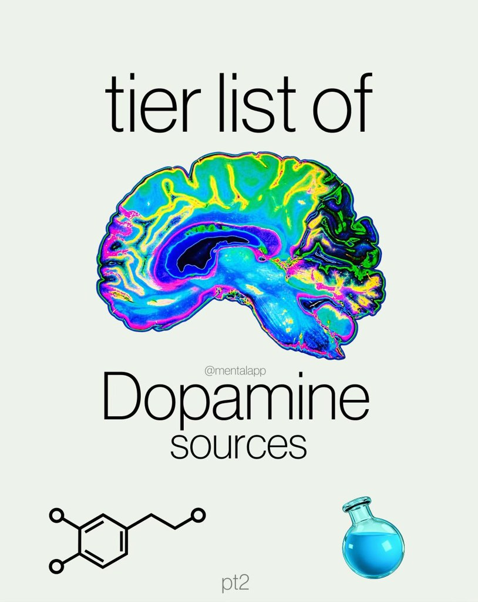
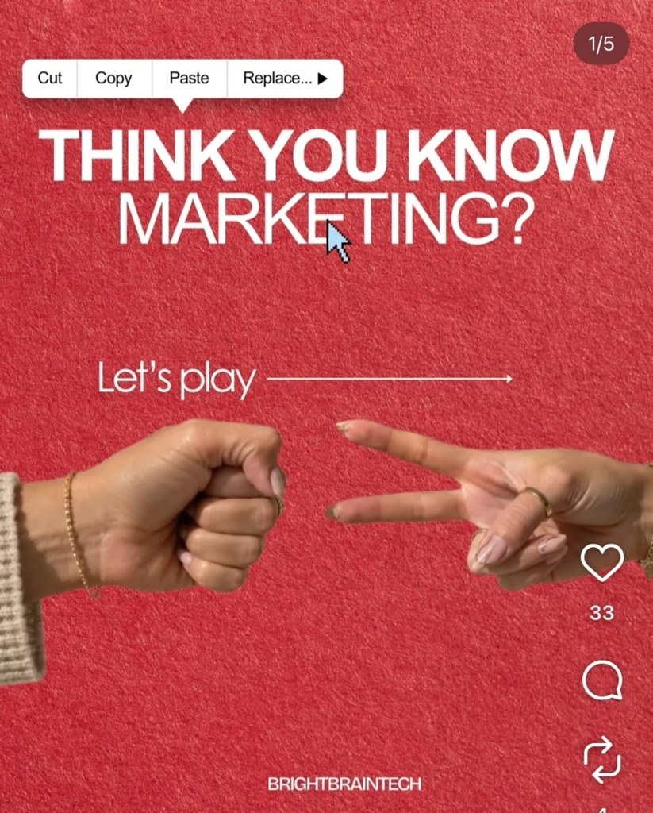
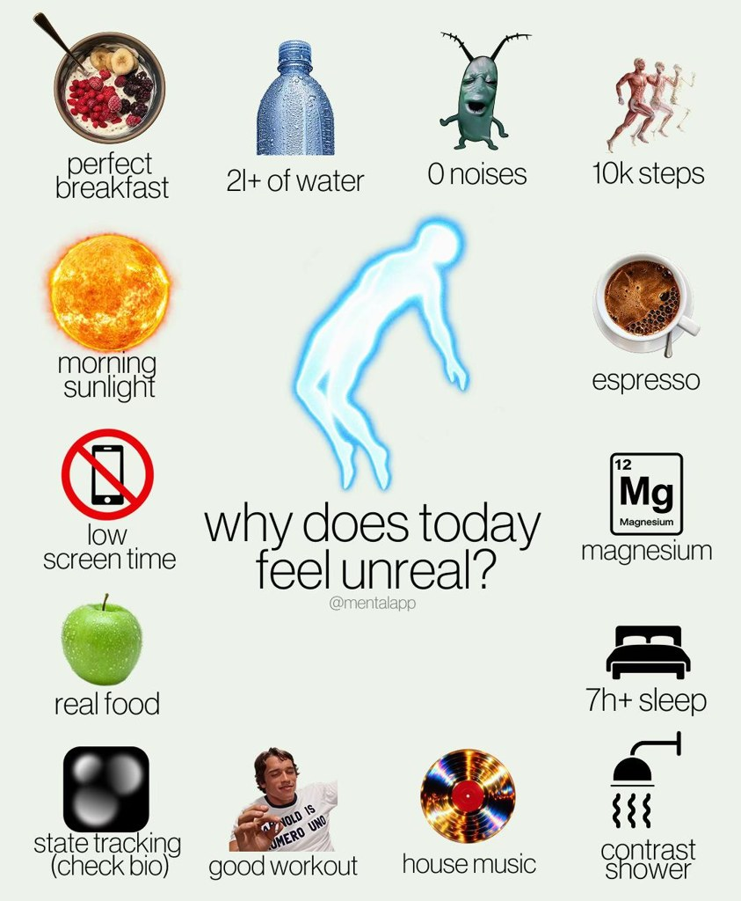

# Other niches (no Amplify brand type yet)

**Brands of this type on Amplify:** 0 · Niches ReelFarm covers that none of Amplify's current brand types sell into. Kept so the database is complete for future brands.

> Dating and mental-health niches carry manipulation-style hooks ('make him obsessed', dark psychology). Fine as format references; check the message before a brand remakes one.

## Slideshow niches (from ReelFarm)

| Niche | Status | Slideshows | Accounts |
|---|---|---|---|
| [relationships](../niches/relationships/README.md) | approved | 25 | 19 |
| [dating](../niches/dating/README.md) | approved | 23 | 16 |
| [spirituality](../niches/spirituality/README.md) | approved | 22 | 12 |
| [faith](../niches/faith/README.md) | approved | 3 | 2 |
| [entertainment](../niches/entertainment/README.md) | approved | 24 | 15 |

## Templates already studied for this type

| | Template | Type | Confidence | Status | What it is |
|---|---|---|---|---|---|
|  | [P010 Quote over candid photo](../../content-bank/P010-quote-over-candid-photo/pillar.md) | slideshow | Low | draft | A single-image post where a short lowercase "the less X the more Y" quote sits mid-frame over a casual, low-light phone photo of people looking unbothered, captioned with an engagement ask and trend hashtags. |
|  | [P012 Still-stare advice quote](../../content-bank/P012-still-stare-advice-quote/pillar.md) | video | Low | draft | A 5-second locked close-up of a still, expressionless face in a dark room, with a credited advice quote on screen from second 0, no caption, over a trending song. |
|  | [P013 Unhinged advice request selfie](../../content-bank/P013-unhinged-advice-request-selfie/pillar.md) | slideshow | Low | draft | A single-slide, tight selfie of an exaggerated distressed face asking a direct, self-deprecating question that invites the wildest possible replies, ruling out the obvious safe answer first. |

## Templates that also work, with a tweak

| | Template | Type | Confidence | Status | What it is |
|---|---|---|---|---|---|
|  | [P021 Tier list chart](../../content-bank/P021-tier-list-chart/pillar.md) | slideshow | Low | draft | A 2-slide opinion carousel on a flat pale card, a "tier list of [topic]" cover around one vivid hero cut-out, then a filled S to D tier chart (plus an F row) of cut-out icons with short lowercase labels and a challenge title that pulls disagreement into the comments. |
|  | [P022 Rock paper scissors myth duel](../../content-bank/P022-rock-paper-scissors-myth-duel/pillar.md) | slideshow | Low | draft | A carousel played as rock paper scissors, two cut-out hands meeting from the left and right edges on a flat textured background, a challenge-question cover and then one round per slide where the losing gesture holds a common belief and the gesture that beats it holds the better move. |
|  | [P023 Habit ring question](../../content-bank/P023-habit-ring-question/pillar.md) | slideshow | Low | draft | A single-image "why does today feel <state>?" card, a glowing centre figure and a thin 2-line question ringed by 14 labelled cut-outs (photo objects, meme cut-outs, flat pictograms) that list the habits behind the good day, with the brand's own app icon slipped in as one habit labelled "(check bio)". |
